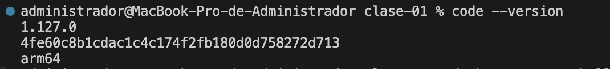
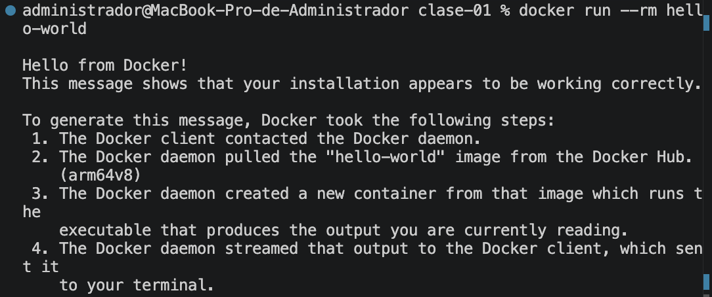
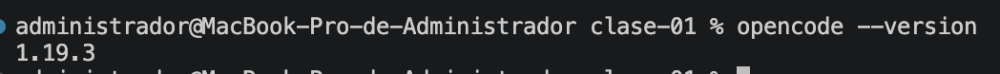
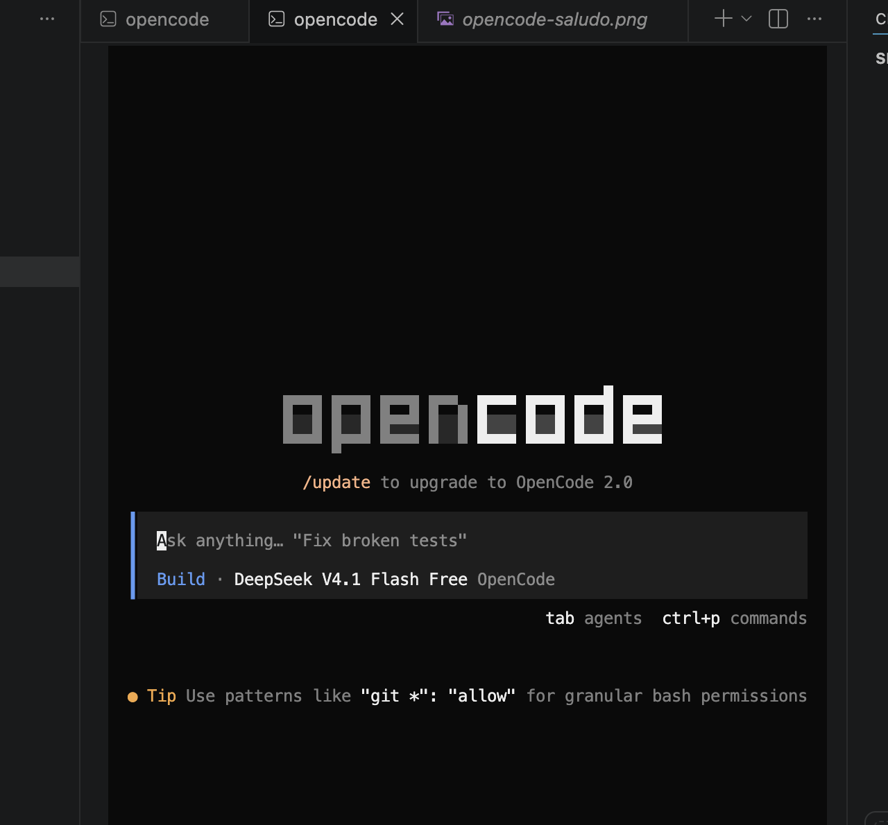
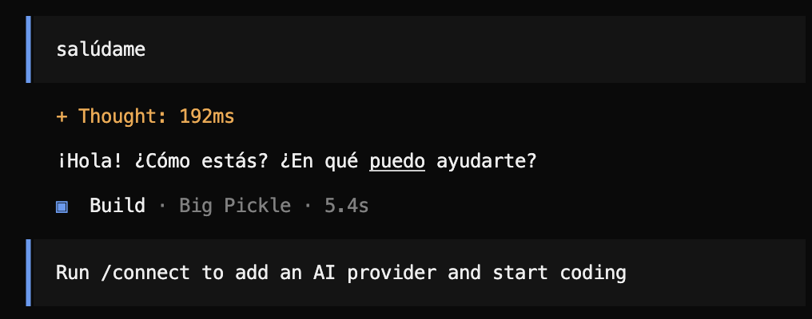

# Evidencias de la clase 01

## 1. Versión de Visual Studio Code

Comando ejecutado: `code --version`

Resultado:

## 2. Prueba de Docker

Comando ejecutado: `docker run --rm hello-world`

Resultado:

## 3. Versión de OpenCode

Comando ejecutado: `opencode --version`

Resultado:

## 4. Prueba de OpenCode en VS Code

Captura de pantalla:

## 5. Respuesta al prompt “salúdame”

Prompt enviado: `salúdame`

Respuesta de OpenCode:

